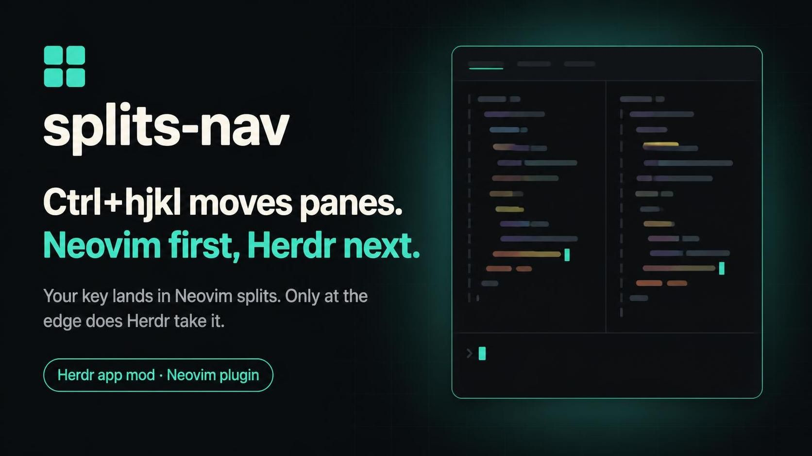

# herdr-mods

App mods for [Herdr](https://herdr.dev), the desktop app for terminals and coding agents. My own
collection.

[中文文档](README.zh-CN.md)

Each mod is a self-contained folder in this repo. Once the repo carries the `herdr-mod` topic it gets
picked up on [herdr.dev/mods](https://herdr.dev/mods), one entry per folder. A mod is plain
JavaScript: it only imports herdr's built-in modules — no HTML/CSS, no web view, no build step.

## splits-nav



`ctrl+h/j/k/l` moves between panes, `alt+h/j/k/l` resizes them. With nvim installed the same keys work
inside nvim, with the same meaning: nvim moves its own splits/windows first and only hands the key
back to herdr at the edge. Inner and outer behaviour stay identical, so there is only one set of
keybindings to remember. The two sides talk over local TCP — no terminal byte injection. If nvim
isn't installed, isn't running, or times out, it silently degrades to moving the herdr pane directly.

Keys are rebindable: by default `cmd+shift+s` opens the settings dialog. Click the key row and
press the new key to record it (Esc cancels; only ctrl/alt/shift plus one letter, digit or arrow key
is accepted, and ctrl or alt is required — the row that opens settings also accepts cmd). Conflicts
are checked, and Apply writes `keys.json`.

### Install

No need to hand-write config. Paste this to your coding agent:

```text
Install the splits-nav mod for herdr-app from https://github.com/TaterDoge/herdr-mods

1. Read splits-nav/RECIPE.md in that repo and follow it exactly.
2. The end state must be: splits-nav/mods/splits-nav/ copied to ~/.config/herdr-app/mods/splits-nav/ as a real folder (not a symlink), the "global" section of splits-nav/keys.json merged into ~/.config/herdr-app/keys.json, the mod's 0×0 floating block mounted in my layouts, and link-nvim run so the nvim half is linked into ~/.config/nvim/plugin.
3. Then run `herdr-app check ~/.config/herdr-app/mods/splits-nav` and show me the output.
```

Manual install in three steps, if you'd rather do it yourself:

1. **Copy** `splits-nav/mods/splits-nav/` to `~/.config/herdr-app/mods/splits-nav/`.
   Don't symlink it — hot reload only works on real folders (see "Gotchas" below).
2. Merge the `global` section of `splits-nav/keys.json` into your own
   `~/.config/herdr-app/keys.json`, or just install first and hit Apply in the dialog.
3. The layout must mount its floating block, otherwise the keys never reach it — a mod only runs
   where the layout you are currently looking at mounts it. You don't have to do this yourself: on
   first load it scans `layouts/*.json` and adds the missing mount to your personal layouts in place.
   It leaves the two built-in layouts (Herdr, Terminals) alone — herdr rewrites those on every start
   — and instead keeps a `main-nav` / `terminals-nav` copy of each; switch to the copy if you want
   them.

The nvim half (`splits-nav/mods/splits-nav/nvim/`) needs no setup either: the first time the mod
loads in a real window it runs `link-nvim` once, symlinking `nvim/plugin/herdr-nav.lua` into
`~/.config/nvim/plugin` (`NVIM_PLUGIN_DIR` overrides the location) and telling you to restart nvim.
It deliberately isn't structured for lazy.nvim and friends: there is no `plugin/` at the repo root,
so installing the repo as a plugin loads nothing.

It works without nvim too — every key just moves/resizes the herdr pane directly.

Details, exact files written, and how to debug it when it breaks are all in
`splits-nav/RECIPE.md`; that document is the most complete one.

## Writing a mod

One published unit (one entry on herdr.dev/mods) is one folder in the repo:

```text
<unit>/
  RECIPE.md          required: how someone else rebuilds it from scratch; the listing blurb is read from here too
  preview.png         required: listing image, real screenshot or promo art, never a placeholder
  keys.json           optional: install template, merged into the user's own keys.json
  mods/<name>/
    main.js           required: default-exports a class extending View
    mod.json          required: { "place": "none|left|right|top|bottom", "title"?, "overlay"? }
    *.js *.svg        optional: modules and icons in the same folder
    fonts/            optional: bundled fonts
    screenshot.png    optional: actual screenshot running in the real app
    nvim/ link-nvim   optional: this mod's own nvim half (linked at install time by link-nvim, see above)
```

`RECIPE.md` and `preview.png` must sit **next to** `mods/`, not at the repo root — at the root they
turn the whole repo into a single unit instead of one unit per mod, and the crawler skips malformed
repos entirely, publishing nothing. Multiple units per repo are officially supported (in the words of
the herdr.dev/mods page). The index lives at
<https://assets.herdr.dev/mods/index.json>; if your repo isn't in it, it was skipped.

A mod may import only `gpui-kit`, `gpui-base`, `herdr`, and siblings via `./x.js`. Shared code across
mods isn't implemented, because relative paths break after symlinking; revisit if a third duplicate
shows up.

### Dev loop

```sh
scripts/link                                  # */mods/* -> ~/.config/herdr-app/mods/* (symlinks, first load only)
herdr-app check splits-nav/mods/splits-nav    # run after every change; exit code 0 means it passes
herdr-app status                              # any errors?
herdr-app shot /tmp/x.png                     # screenshot to see what actually renders
```

API docs: `~/.config/herdr-app/AGENTS.md`. It is the only authoritative copy, it is rewritten on every
app start, and you should not edit it (file an issue here instead). `herdr.d.ts` and `gpui-kit.d.ts`
are real types, and the app also writes `jsconfig.json` into the mod folder when it loads it, so you
get completion in your editor out of the box.

**Gotchas**: hot reload only applies to **real folders** inside `~/.config/herdr-app/mods/`. A
symlinked mod is not reloaded after an edit, and `herdr-app status` reports nothing wrong — the old
code just keeps running. Measured 2026-10-31: same code, no reload while symlinked, immediate reload
once the folder was real. So to change logic, either restart the app or copy the folder in as a real
directory.

## Publishing

Prerequisites: `herdr-app check` passes, `preview.png` is the listing image, and `RECIPE.md` follows
the layout above. Push to a public repo, add the `herdr-mod` topic, and it should show up on
herdr.dev/mods within roughly an hour.