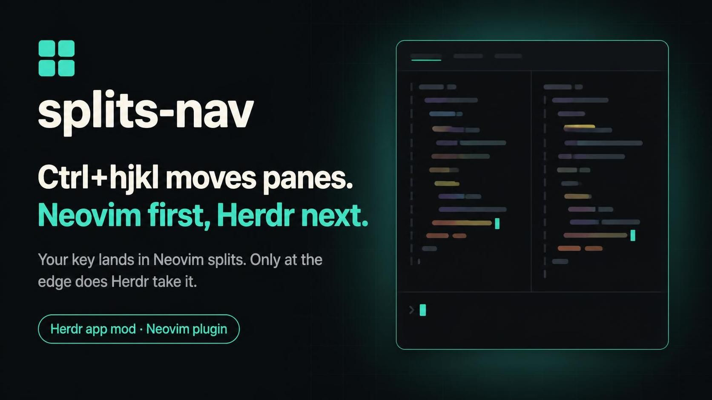

# herdr-mods

给 [Herdr](https://herdr.dev)（终端与 coding agent 的桌面 app）写的 app mod，我自己的收藏。

[English](README.md)

每个 mod 在这个仓库里是一个自成一体的文件夹，仓库加 topic `herdr-mod` 之后会被抓到
[herdr.dev/mods](https://herdr.dev/mods) 上，一个文件夹一条。mod 就是纯 JavaScript，
只依赖 herdr 自带的模块，没有 HTML/CSS、没有 web view、也没有构建步骤。

## splits-nav



`ctrl+h/j/k/l` 在 pane 之间移动，`alt+h/j/k/l` 调整大小。装了 nvim 的话这两个键在
nvim 里也能用，而且是同一套语义：nvim 先切自己的 split/窗口，到边缘了才把键交回给
herdr 去动 pane。这样内层和外层行为一致，不用记两套键。两边靠本机 TCP 说话，不做终端
字节注入；nvim 没装、没启动、或超时，就默默退化成直接动 pane。

按键可改：默认 `cmd+shift+s` 弹设置对话框，点对应键行直接按下新键即可录入（Esc 取消；
只认 ctrl/alt/shift + 一个字母、数字或方向键，且必须带 ctrl 或 alt；打开设置那行还认 cmd），带冲突检查，Apply 会写 `keys.json`。

### 安装

不用手写配置，把下面这段粘给你的 agent 就行：

```text
帮我安装 https://github.com/TaterDoge/herdr-mods 里的 splits-nav mod（给 herdr-app 用）

1. 读那个仓库里的 splits-nav/RECIPE.zh-CN.md（中文版），严格照着做。
2. 最终状态必须是：splits-nav/mods/splits-nav/ 被复制到 ~/.config/herdr-app/mods/splits-nav/（真目录，不是软链）；splits-nav/keys.json 的 "global" 段合进 ~/.config/herdr-app/keys.json；在我的布局里挂上它的 0×0 floating 块；跑一次 link-nvim，把 nvim 半件链进 ~/.config/nvim/plugin。
3. 然后跑 `herdr-app check ~/.config/herdr-app/mods/splits-nav`，把输出给我看。
```

想自己动手，就手工装三步：

1. 把 `splits-nav/mods/splits-nav/` **复制**成 `~/.config/herdr-app/mods/splits-nav/`。
   别用软链，热重载只认真目录（见下面「坑」）。
2. 把 `splits-nav/keys.json` 的 `global` 段并进你自己的 `~/.config/herdr-app/keys.json`，
   或者装好后直接用对话框 Apply 写一遍。
3. 布局里得挂一块它的 floating，按键才真到它手里 —— mod 只在你正看的布局挂了它的地方跑。
   这步也不用你动手：首次加载时它会扫 `layouts/*.json`，缺挂载的个人布局原地补一块；
   Herdr 自带的那两个（Herdr、Terminals）它不写（自带布局每次启动被重写），改为各留一份
   `main-nav` / `terminals-nav` 副本，想用就切到副本。

nvim 半件（`splits-nav/mods/splits-nav/nvim/`）也不用你配：mod 第一次在真实窗口里加载时
自动跑一次 `link-nvim`，把 `nvim/plugin/herdr-nav.lua` 软链进 `~/.config/nvim/plugin`
（`NVIM_PLUGIN_DIR` 可改位置），提示你重启 nvim。它不进 lazy.nvim 之类包管理器：仓库根
没有 `plugin/`，当插件装进来不会加载任何东西。

不装 nvim 也能用，只是所有键都变成直接动 herdr pane。

细节、写哪些文件、坏了自己怎么查，都在 `splits-nav/RECIPE.zh-CN.md` 里（上架那份 `RECIPE.md` 是英文版，内容一样）；那是最全的一份。

## 加一个 mod

一个上架单元（herdr.dev/mods 上的一条）就是仓库里的一个文件夹：

```text
<unit>/
  RECIPE.md          必须：别人从零重建它的说明，app 上架页的简介也从这里读
  preview.png        必须：上架图，真截图或宣传图都行，不能是占位符
  keys.json          可选：安装模板，合进用户自己的 keys.json
  mods/<name>/
    main.js          必须：默认导出 extends View 的类
    mod.json         必须：{ "place": "none|left|right|top|bottom", "title"?, "overlay"? }
    *.js *.svg       可选：同文件夹的模块与图标
    fonts/           可选：自带字体
    screenshot.png   可选：跑在真 app 里的实际截图
    nvim/ link-nvim  可选：这个 mod 自己的 nvim 半件（装的时候由 link-nvim 链接，见上）
```

`RECIPE.md` 和 `preview.png` 必须和 `mods/` **同层**，放在仓库根不算 —— 放根上就变成
「整个仓库一条」而不是每个 mod 一条，形状不对爬虫会跳过整个仓库，一条都不出。
一个仓库放多条是官方支持的（herdr.dev/mods 页原话）。索引在
<https://assets.herdr.dev/mods/index.json>，搜不到自己的仓库就是被跳过了。

mod 里能 import 的只有 `gpui-kit`、`gpui-base`、`herdr`，以及同文件夹的 `./x.js`。
跨 mod 共用代码没做，因为软链之后相对路径会错；真出现第三次重复再说。

### 开发循环

```sh
scripts/link                                  # */mods/* -> ~/.config/herdr-app/mods/*（软链，只用于首次装载）
herdr-app check splits-nav/mods/splits-nav    # 每次改完跑，退出码 0 才算过
herdr-app status                              # 有没有报错
herdr-app shot /tmp/x.png                     # 截图看实际渲染
```

接口文档看 `~/.config/herdr-app/AGENTS.md`。它是唯一权威的一份，每次 app 启动都会被重写，
别编辑它（要改就在这里提 issue）。`herdr.d.ts` 和 `gpui-kit.d.ts` 是真类型，app 加载 mod 时
还会往 mod 文件夹写 `jsconfig.json`，所以编辑器里直接有补全。

**坑**：热重载只对 `~/.config/herdr-app/mods/` 里的**真文件夹**生效。软链进去的 mod 改完
不会被重新加载，`herdr-app status` 也不报错，就是旧代码一直在跑。2026-10-31 实测：同一份
代码，软链时不生效，改成真目录立刻就生效了。所以改逻辑要么重启 app，要么把文件夹复制成
真目录。

## 发布

前提是 `herdr-app check` 过了、`preview.png` 是上架用的图、`RECIPE.md` 按上面的形状写好。
推到公开仓库、给仓库加上 topic `herdr-mod`，大致一小时内出现在 herdr.dev/mods 上。