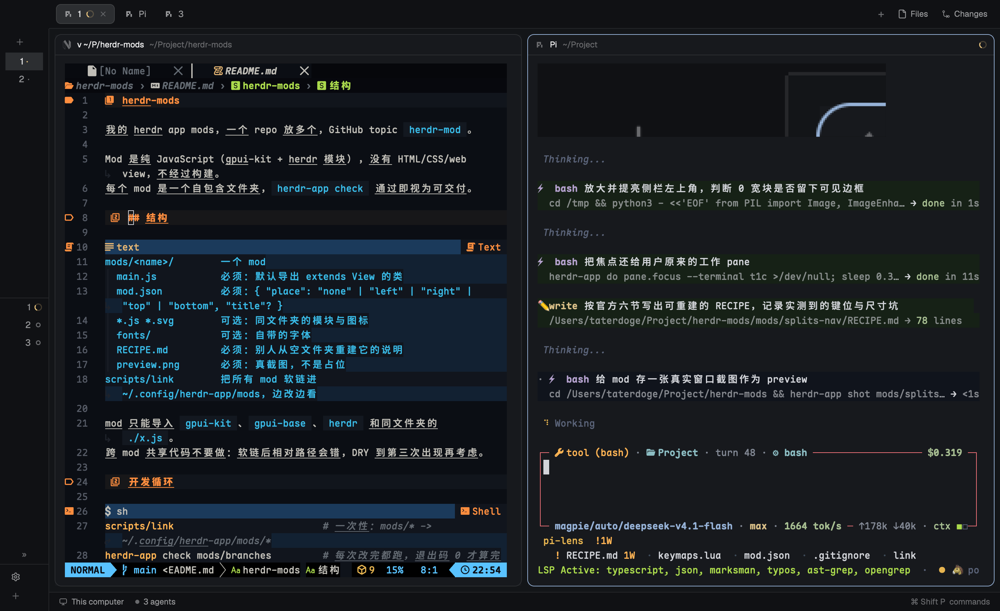

# Splits Nav

`ctrl+h/j/k/l` 在 pane 之间移动，但焦点在 nvim 里时把键原样送进 nvim，让 nvim
切自己的窗口 —— herdr 直接用 `pane.go` 会在全局把键吃掉，nvim 永远收不到。

## What you see

mod 自己不画任何东西。它是一个托管在布局 floating 槽里的空块（0×0，纯背景色，
不可见、不挡点击，`peek: 0` 让它永不滑出）。

能看到的变化只有两个：

- 在普通终端 pane 上按 `ctrl+h/j/k/l`，焦点移到相邻 pane。
- 在 nvim pane 上按同样的键，键进 nvim：normal/visual 模式切 nvim 自己的窗口，
  插入模式是 nvim 自己配置的光标移动。

## How it behaves

- 键绑定是 `mod:splits-nav` 段的 `<mod>.<command>`：`ctrl-h` → `splits-nav.left`，
  以此类推。herdr 只把键命令投递给**已显示的** mod 副本，所以这个 mod 必须占一个
  可见块 —— floating 托管块就是干这个的，它只要不是 `hidden` 就算可见。
- 收到命令后读 `focused()` 拿焦点 pane，`panes()` 里找到它，看 `program.key`：
  - `nvim` / `vim` / `gvim` / `view` → `hc(["keys", pane.terminal, "ctrl+h"])`，
    键写进那个 pane 的 PTY。远程 pane 的地址是 `machine/t7`，`hc keys` 认这种写法。
    这一步**不 await**：`hc` 每次要起一个进程（实测约 40 ms），等着它会把连按的
    键排成一队，按得越快越滞后。
  - 其他程序（shell、agent、lazygit…）→ `run("pane.go", { direction })`。
  - mod pane（`terminal` 为 null）→ 不做任何事。
- 到边缘就停：`pane.go` 没有相邻 pane 时什么都不发，不做 wrap，也不取消 zoom
  （旧 herdr-tui 插件会先取消 zoom，这里第一版没做）。

## Built from

- `mods/splits-nav/main.js`：默认导出一个 `SplitsNav extends View`；
  `init` 里 `cx.spawn` 一个 `for (;;)` 等 `await nextCommand()`；
  `render` 返回 `div().w(0).h(0)` —— `check` 不接受 `null`，空字符串会画出 26px 高的空框。
- `mod.json`：`{ "place": "none", "title": "Splits Nav" }`，不自动停靠。
- 宿主布局：`layout.clone {name: "main", as: "main-mine"}`，然后在 `sidebar` 节点上
  加
  `"floating": [{ "id": "splits-nav", "content": { "mod": "splits-nav" }, "edge": "left", "align": "start", "peek": 0 }]`。
  挂在 `sidebar` 而不是根节点，是为了让空块的 26px 落在侧栏顶部而不是窗口中央的
  tab 条上。
- `keys.json` 的 `global` 段：原来 `ctrl-h/j/k/l` 指向 `pane.go:*`，改成 `splits-nav.*`。
- nvim 侧（`~/.config/nvim/lua/config/keymaps.lua`）：`PANE` 表 + `has_neighbor(dir)`
  + `nav(dir)`。`has_neighbor` 用 `win_screenpos` 比较每个窗口的行/列，判断那个方向
  还有没有窗口（不能靠 `wincmd` 后比窗口：它会 wrap 到对面）。有窗口就 `wincmd`，
  没有就
  `vim.fn.jobstart({ "herdr-app", "do", "pane.go:" .. PANE[dir] }, { detach = true })`
  —— 用 jobstart 而不是 `vim.fn.system`，否则每次按键要把 nvim 卡住一个进程的时间。
  API 是 `nvim_get_current_win()`，没有 `nvim_current_win()`。
  插入模式的 `"i"` 映射原本就有（`<C-h>` → `<Left>` 等），不动。
- 用到的东西：`focused`、`panes`、`nextCommand`、`hc`、`run`；没有 exec，没有网络。

## Watch out

- **连按会卡是因为串行 await**，不是 herdr 本身慢：`hc` 单次约 40 ms，`await`
  之后五个键就是 5×40 ms 排队。去掉 await 后命令立即读完，hc 各自并发。
- **`ctrl+j` 在终端层等于 Enter**（都是 0x0A）。实测 `hc keys t1b ctrl+j` 不会让 nvim
  下移，所以 nvim 里 `<C-j>` 实际收不到，那条 `<C-j>` 映射在 herdr 里等于没有。
  `ctrl+h`（0x08）、`ctrl+k`、`ctrl+l` 正常。要跨 pane 上下移动，用现成的
  `cmd-alt-up` / `cmd-alt-down`。
- `ctrl+k` / `ctrl+l` 在 shell 里本来是 kill-line 和清屏，绑给 mod 之后 shell 收不到
  了。这是拿全局键换统一方向键的代价，不是 bug。
- 该方向已经没有 nvim 窗口时（只有一个窗口，或者已经是最后一个/最左边的窗口），
  键进 nvim 后由 nvim 调 `herdr-app do pane.go:left` 把焦点交给 herdr。
  整条链过两次进程（mod 的 `hc keys`、nvim 的 `herdr-app do`），比纯 shell pane
  慢一点，但能切。还有窗口时只切 nvim 窗口，不离开她的 pane —— 内层导航优先。
- `render` 不能返回 `null`（check 报 `render(cx) must return an element, an Entity, or a string`），
  返回 `""` 会画出高 26px 的空框，必须用 `div().w(0).h(0)` 才真的 0 尺寸
  （实测 `floats` 的 bounds 变成 `[x, y, 0, 0]`… 实际仍报 26px 高但内容 0 宽，
  截图确认那片像素纯背景色）。
- 布局克隆不跟随 Herdr 更新：`main-mine` 里的 `main` 内容永远停在克隆那一刻。
  想拿回新版 main 的改动，重新 `layout.clone` 一次再加 floating。
- 只投递给已显示的副本：如果切到了没有这个 floating 块的布局（比如 `terminals`、
  `win98`），`ctrl+h` 会变成无人接收的键，什么都不发生。

## Done when

- `herdr-app check ~/.config/herdr-app/mods/splits-nav` 退出码 0。
- `herdr-app status` 的 `floats` 里有 `splits-nav`，`errors` 为空。
- 焦点放在一个非 nvim pane 上，执行 `herdr-app do splits-nav.left`，`status` 的
  `focused_pane` 变成左边的 pane。
- 焦点在 nvim pane 上，`herdr-app do splits-nav.right` 之后 `focused_pane` 不变
  （键被转发，不是 move）。
- nvim 只有一个窗口时按 `ctrl+l`，焦点跳到右边的 pane；`:vsplit` 出两个窗口、
  焦点在最右窗口时再按 `ctrl+l`，也跳到右边的 pane（`wincmd l` 会 wrap，所以不能
  靠它）；焦点在左窗口时按 `ctrl+l`，只在 nvim 内部换窗口，`focused_pane` 不变。
- 按住 `ctrl+h` 连发五下，界面不滞后（hc 调用不阻塞命令读取）。
- 按 `ctrl+h` 键（不是 `do`）与上面的结果一致：说明 `keys.json` 的路由也对。
- 侧栏顶部左上角没有多余边框：截图那块区域只有一个背景色。