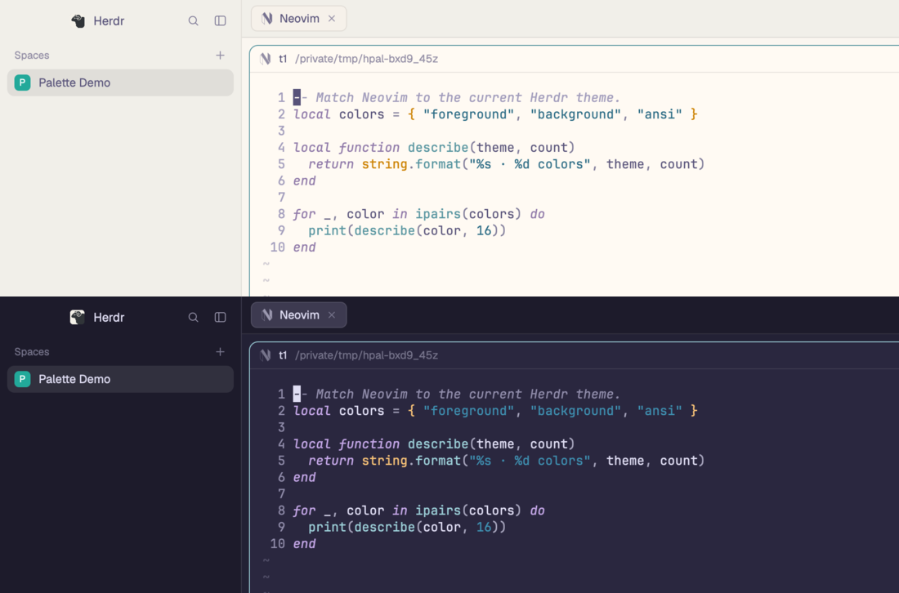

# Neovim Palette

Switch the Herdr App theme and Neovim follows it live. The mod gives ColorRex the terminal foreground, background, and all 16 ANSI colors, so changing between themes of the same lightness updates syntax highlighting too.

[中文](RECIPE.zh-CN.md)



## What you see

Your existing Herdr layout and Neovim editor. The mod is a 0×0 floating block. Neovim's syntax colors follow the active Herdr theme, and the terminal provides the editor background.

## How it behaves

Switch themes from Herdr's theme picker. Running Neovim instances using `herdr-palette` refresh their highlights and 16 ANSI colors. Choosing another Neovim colorscheme pauses syncing for that instance. Run `:colorscheme herdr-palette` to resume. The layout watcher repairs personal layouts after an updater replaces them, even while Herdr is closed.

## Install

Use Herdr App and Neovim 0.12 or later on the same machine. Tested with Herdr App 0.1.16 and Neovim 0.12.6 on macOS.

1. From the repository root, copy the mod into your Herdr App home as a real directory. Review any existing copy before replacing it.

   ```sh
   herdr_config="${HERDR_APP_HOME:-$HOME/.config/herdr-app}"
   mkdir -p "$herdr_config/mods"
   cp -R "nvim-palette/mods/nvim-palette" "$herdr_config/mods/"
   herdr-app check "$herdr_config/mods/nvim-palette"
   ```

2. Install the layout watcher once (Node.js 22.7+). It adds the 0×0 floating mount to every personal layout and puts it back when an updater replaces one. Herdr's own layouts are never written; clone one with `herdr-app do layout.clone '{"name":"main","as":"main-palette"}'` to sync there.

   ```sh
   node "${HERDR_APP_HOME:-$HOME/.config/herdr-app}/mods/nvim-palette/layout-watch.mjs" install
   ```

   Without the watcher, add this entry to the top-level `floating` array of each personal layout, keeping existing entries:

   ```json
   { "id": "nvim-palette", "content": { "mod": "nvim-palette" } }
   ```

3. With a mounted layout selected, check that `nvim-palette.json` appears in the Herdr App home. For plain Neovim, add the following after your default colorscheme in `init.lua`. If you already manage ColorRex through a plugin manager, use that manager to load the tested revision below instead of `vim.pack.add()`.

   ```lua
   local herdr_home = vim.env.HERDR_APP_HOME or vim.fn.expand("~/.config/herdr-app")
   vim.opt.rtp:append(vim.fs.joinpath(herdr_home, "mods/nvim-palette/nvim"))
   vim.pack.add({
     {
       src = "https://github.com/reklai/colorrex.nvim",
       version = "bddcaf9f166ef4b88a04797331430ef7b46d46f1",
     },
   })
   require("herdr-palette").setup()
   ```

   Open Neovim in Herdr and accept the ColorRex install prompt on first use. `setup()` selects `herdr-palette` in a herdr-core terminal once the palette file exists.

### LazyVim

Use this plugin spec in `lua/plugins/` in place of the `vim.pack` example. Merge it into existing specs for ColorRex and LazyVim if present. Set `"habamax"` to your usual colorscheme.

```lua
local herdr_home = vim.env.HERDR_APP_HOME or vim.fn.expand("~/.config/herdr-app")
vim.opt.rtp:append(vim.fs.joinpath(herdr_home, "mods/nvim-palette/nvim"))
local palette = require("herdr-palette")

return {
  {
    "reklai/colorrex.nvim",
    commit = "bddcaf9f166ef4b88a04797331430ef7b46d46f1",
    lazy = false,
    priority = 1000,
    config = function() end, -- Load the compiler without activating the colorrex scheme.
  },
  {
    "LazyVim/LazyVim",
    opts = {
      colorscheme = function()
        vim.cmd.colorscheme(palette.available() and "herdr-palette" or "habamax")
      end,
    },
  },
}
```

## Built from

- `mod.json` uses `place: "none"`. A layout's floating entry mounts the exporter.
- `layouts.js` holds the mount rules: it appends a 0×0 float to a personal layout unless the mod is already mounted anywhere in the tree. `layout-sync.mjs` applies those writes once with an expected-text guard, and `layout-watch.mjs` registers it as a per-user launchd/systemd job watching `layouts/` and `installed.json`. Herdr's own layouts come from `installed.json`, so they are never written.
- `main.js` reads `theme()`, including `terminal_foreground`, `background`, `cursor`, and `ansi0` through `ansi15`. It matches the terminal renderer's RGB values and writes `nvim-palette.json` in `appHome()` only when colors change. `checking()` guards the write during mod checks.
- The `nvim/` runtime loads that JSON as `herdr-palette` using ColorRex's compiler. It watches the palette's directory with `vim.uv.new_fs_event()` so updates still arrive after Herdr replaces the file atomically.
- The mod writes `nvim-palette.json` and, through `layout-sync.mjs`, personal layout files missing the mount. Herdr's own layouts are read-only. Sync uses local files. The Neovim setup snippet downloads ColorRex on first install.

## Watch out

- Use the same `HERDR_APP_HOME` for Herdr and Neovim if you customize that path. This setup covers local Neovim sessions.
- A personal layout that omits the floating entry retains the last exported colors when no watcher is installed. The watcher adds the entry back after an update; without it, add it by hand.
- The watcher never writes Herdr's own layouts. Clone one to sync a built-in layout.
- The integration uses ColorRex's internal compiler. The setup examples pin the tested revision.
- If another Neovim setting changes `background` on focus, have it skip that change while `vim.g.colors_name == "herdr-palette"`.

## Done when

- `herdr-app check` accepts the copied mod and a mounted layout creates `nvim-palette.json` with 16 ANSI colors.
- From the repository root, run `node nvim-palette/selftest-layouts.mjs`. It checks idempotent mounting and repair after an updater replaces a layout.
- In an open Neovim, `:colorscheme` reports `herdr-palette`. Switch between two light themes and then a dark theme in Herdr. Syntax colors and `g:terminal_color_0` through `g:terminal_color_15` update in the same process.
- Run `:colorscheme habamax` in Neovim and switch the Herdr theme again. Neovim keeps the selected scheme.
- From the repository root, run `nvim --headless --clean -l "nvim-palette/selftest.lua" "/path/to/colorrex.nvim"` with the tested ColorRex checkout. This checks Neovim startup and reload after atomic replacement.
