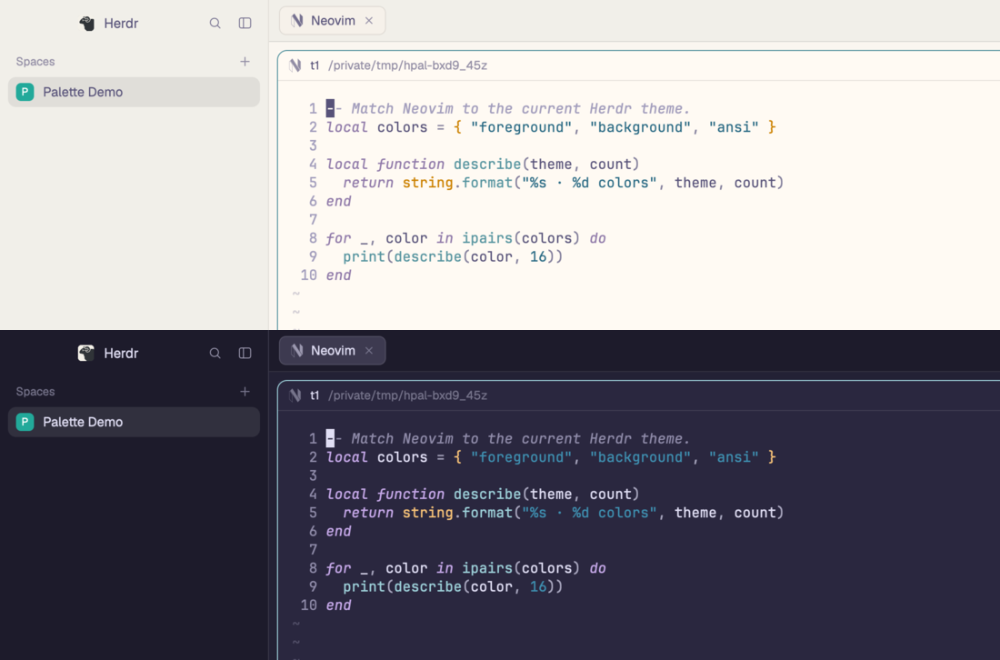

# Neovim Palette

在 Herdr App 里切换主题，正在运行的 Neovim 会跟着换色。mod 把终端前景、背景和完整的 16 色 ANSI 色板交给 ColorRex，同为浅色或同为深色的主题切换也会更新语法高亮。

[English](RECIPE.md)



## 安装

Herdr App 和 Neovim 需在同一台机器运行，Neovim 需 0.12 或以上。已在 macOS 的 Herdr App 0.1.16 和 Neovim 0.12.6 上验证。

1. 在仓库根目录运行以下命令，把 mod 复制成真目录。如果已有同名目录，先检查原有文件。

   ```sh
   herdr_config="${HERDR_APP_HOME:-$HOME/.config/herdr-app}"
   mkdir -p "$herdr_config/mods"
   cp -R "nvim-palette/mods/nvim-palette" "$herdr_config/mods/"
   herdr-app check "$herdr_config/mods/nvim-palette"
   ```

2. 安装一次布局监听（Node.js 22.7+）。它会给每个个人布局加上这个 0×0 浮动挂载，并在更新器替换布局后补回。Herdr 自带布局不会被写入；想在内置布局同步，先建个人副本，例如 `herdr-app do layout.clone '{"name":"main","as":"main-palette"}'`。

   ```sh
   node "${HERDR_APP_HOME:-$HOME/.config/herdr-app}/mods/nvim-palette/layout-watch.mjs" install
   ```

   不装监听时，手动在每个个人布局顶层 `floating` 数组里加入下面这项，保留原有条目：

   ```json
   { "id": "nvim-palette", "content": { "mod": "nvim-palette" } }
   ```

3. 切到已挂载的布局，确认 Herdr 配置目录生成了 `nvim-palette.json`。把 `nvim/` 加入 Neovim 的 `runtimepath`，加载指定版本的 ColorRex，再启用 `herdr-palette`。按你的配置选择 [原生 Neovim 初始化示例](RECIPE.md#install) 或 [LazyVim 插件配置示例](RECIPE.md#lazyvim)。

## 使用

在 Herdr 内打开 Neovim，运行 `:colorscheme` 应显示 `herdr-palette`。在 Herdr 中切换主题，编辑器语法高亮和 16 色 ANSI 色板会随之更新。在 Neovim 里选择其他配色会暂停本会话的同步，运行 `:colorscheme herdr-palette` 即可恢复。布局监听会在更新器替换个人布局后补回挂载，Herdr 关闭时也能工作。

## 工作方式

Herdr 的 0×0 浮动块读取当前主题并原子写入 `nvim-palette.json`。Neovim 监听文件所在目录，每次更新时用 ColorRex 编译同一份色板。`layouts.js` 负责挂载规则，`layout-sync.mjs` 带原文校验地修一次，`layout-watch.mjs` 把它注册成监听 `layouts/` 与 `installed.json` 的用户级 launchd/systemd 任务。同步走本机文件，只有安装 Neovim 依赖时需要下载 ColorRex。

自定义 `HERDR_APP_HOME` 时，Herdr 和 Neovim 需读取同一目录。没装监听时，布局文件被更新器替换后要手动补回浮动块。Herdr 自带布局不会被监听改写，需先建个人副本。如果你的 Neovim 配置会在窗口获得焦点时修改 `background`，让它在 `vim.g.colors_name == "herdr-palette"` 时跳过。安装示例固定了已验证的 ColorRex 提交，因为 mod 使用其内部编译接口。
